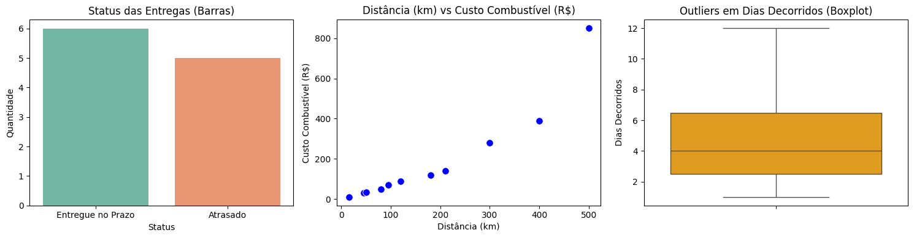

# 03 - Análise de Dados e Indicadores Operacionais (LogExpress)

**Disciplina:** Análise de Dados / Inteligência de Negócios  
**Projeto:** Otimização e Segurança LogExpress  

---

## 2.1 Tratamento de Dados (ETL) e KPIs
- **Tratamento de Dados (ETL): Foi realizada a remoção dos registros com valores nulos na coluna "dias_decorridos", utilizando a biblioteca "pandas" no Google Colab.
- **KPI 1 - Taxa de Entregas no Prazo: 54,5% das entregas foram realizadas dentro do prazo.
- **KPI 2 - Custo Médio por Frete: R$ 319,14.
- **Faturamento Total Mapeado:** R$ 3.510,50.

---

## 2.2 Análise Estatística Descritiva
- **Média de Dias Decorridos:** 5,00 dias.
- **Desvio Padrão dos Atrasos:** 3.38 dias (indicando variação nos tempos de entrega observados).
- **Correlação de Pearson (Distância vs. Custo de Combustível):** 0.93 (indicando forte associação positiva entre a distância percorrida e o custo de combustível na base analisada.).

---

## 2.3 Visualização de Dados
O notebook `analise.ipynb` gera três gráficos principais para análise operacional:
1. **Gráfico de Barras:** Comparativo entre entregas no prazo e entregas em atraso.
2. **Gráfico de Dispersão:** Relação linear entre a distância percorrida (km) e o custo com combustível (R$).
3. **Boxplot:** Identificação de *outliers* de tempo nos fretes de longa distância.

---

## 2.4 Análise Crítica (Conexão com a Gestão do Projeto)

**Pergunta Exigida:** *Baseado nas correlações estatísticas, nos outliers encontrados e no principal KPI calculado, qual é o maior gargalo operacional da empresa?*

**Resposta e Diagnóstico:**
O principal gargalo operacional identificado é a pontualidade das entregas. A taxa de entregas realizadas dentro do prazo é de 54,5%, indicando que apenas pouco mais da metade dos pedidos analisados foi entregue pontualmente. Além disso, o boxplot permite investigar valores atípicos no tempo de entrega, como o pedido 111, que levou 12 dias para ser concluído, embora o prazo previsto fosse de 5 dias. Esse caso evidencia uma diferença de 7 dias entre o prazo previsto e o tempo efetivamente decorrido.

A correlação de Pearson de 0,93 demonstra uma forte associação positiva entre a distância percorrida e o custo de combustível, indicando que rotas mais longas tendem a estar associadas a maiores gastos com combustível nesta base. Esse fator deve ser considerado no planejamento logístico, embora não seja, isoladamente, prova de que a distância seja a causa de todos os atrasos.

Do ponto de vista operacional, recomenda-se revisar o planejamento das rotas, acompanhar os pedidos com maior risco de atraso e monitorar conjuntamente a pontualidade, os tempos de entrega e os custos de combustível. Essas medidas podem apoiar decisões de melhoria, mas sua eficácia deverá ser avaliada com dados operacionais adicionais e acompanhamento dos indicadores ao longo do tempo.
